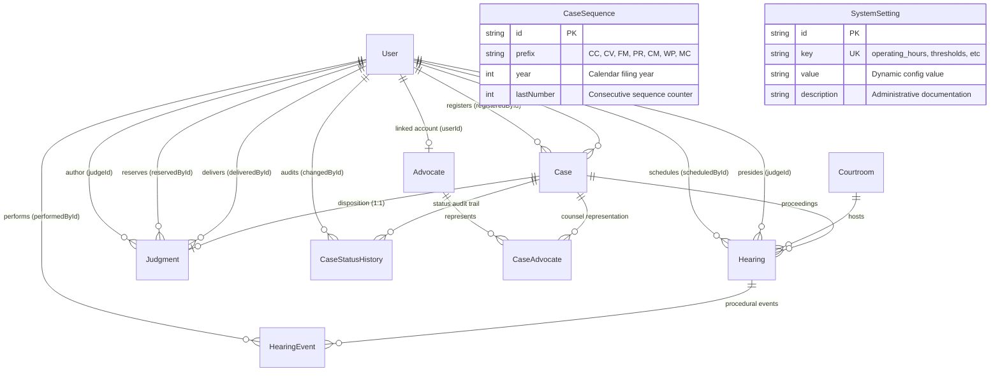

# Court Case Management System

## Problem

Indian courts face a staggering pendency of over 5.3 crore cases across district and subordinate courts. Much of this chronic backlog stems from manual, disconnected case tracking, lack of procedural accountability, missed procedural deadlines, unmonitored court adjournment cycles, and lack of real-time registry visibility.

## Solution

A unified, full-stack, enterprise-grade Judicial Registry and Case Tracking System that links case filing, advocate assignment, hearing scheduling, trial proceedings, and judgment disposition into a single shared, audited legal docket. Case status advances or reverts automatically as procedural steps occur. An integrated Automation Engine and Registry Dashboard continuously computes caseload telemetry, flags aging backlogs, detects stagnating cases, and monitors judicial workloads without caching lag.

> **Scope Note**: The Evidence module was removed by deliberate architectural decision in Phase 6B to maintain judicial record integrity and focus on docket flow; the initial migration history retains the historical table dropping, as intended.

---

## Roles & Access Control Summary

The system defines four mutually exclusive, strictly enforced roles:

1. **ADMIN**: Court Superadministrator. Full system authority (`*`), personnel onboarding, credentials management, system parameter & threshold configuration, registry audit oversight.
2. **REGISTRAR**: Court Registry Officer / Clerk. Case registration, counsel assignment/unassignment, courtroom hearing scheduling, rescheduling, cancellation, and registry dashboard monitoring. Cannot deliver judgments or modify user accounts.
3. **JUDGE**: Judicial Officer / Presiding Magistrate. Presides over allocated courtrooms, conducts trial hearings, records hearing outcomes, grants reasoned adjournments, reserves judgments, and authorises operative judgments closing dockets. Cannot register cases or assign counsel.
4. **ADVOCATE**: Legal Counsel / Bar Advocate. Restricted strictly to viewing cases where they are actively retained as counsel, inspecting their daily hearing cause lists, and monitoring personal caseload statistics. Read-only access to their client cases.

---

## Complete Case Status Lifecycle

The court case record follows an automated, state-machine-driven lifecycle across 6 formal states:

```
[ REGISTERED ]
       │  ▲
       │  │ (last counsel unassigned)
       ▼  │
[ ADVOCATE_ASSIGNED ]
       │  ▲
       │  │ (hearing cancelled / adjourned without next date)
       ▼  │
[ HEARING_SCHEDULED ]
       │
       │ (first hearing completed)
       ▼
[ UNDER_TRIAL ] ◄──┐ (further hearings completed / adjourned with next date)
       │         └──┘
       │ (all hearings complete & oral arguments closed)
       ▼
[ JUDGMENT_RESERVED ]
       │
       │ (operative judgment delivered)
       ▼
[ CLOSED ] (Read-only legal artifact; permanent immutability)
```

### Full Case Status Automation Matrix

| Initial State       | Target State        | Triggering Event / API Endpoint                          | Business Rules & Invariants                                                                          | Automated By             |
| ------------------- | ------------------- | -------------------------------------------------------- | ---------------------------------------------------------------------------------------------------- | ------------------------ |
| `—`                 | `REGISTERED`        | `POST /api/v1/cases`                                     | Case filed by Registrar/Admin; auto-generates consecutive sequence (e.g. `CC/2026/00101`).           | `case.controller.js`     |
| `REGISTERED`        | `ADVOCATE_ASSIGNED` | `POST /api/v1/cases/:id/advocates`                       | First active counsel assigned to petitioner or respondent.                                           | `caseWorkflow.js`        |
| `ADVOCATE_ASSIGNED` | `REGISTERED`        | `POST /api/v1/cases/:id/advocates/:advId/unassign`       | Last remaining counsel unassigned with mandatory legal reason. Reverts status automatically.         | `caseWorkflow.js`        |
| `ADVOCATE_ASSIGNED` | `HEARING_SCHEDULED` | `POST /api/v1/hearings`                                  | First active hearing scheduled in available courtroom/slot by Registrar. Case `judgeId` set.         | `caseWorkflow.js`        |
| `HEARING_SCHEDULED` | `ADVOCATE_ASSIGNED` | `POST /api/v1/hearings/:id/cancel`                       | Active scheduled hearing cancelled before occurrence; 0 active hearings remain. Reverts status.      | `caseWorkflow.js`        |
| `HEARING_SCHEDULED` | `ADVOCATE_ASSIGNED` | `POST /api/v1/hearings/:id/adjourn`                      | Hearing adjourned without specifying a next hearing date; 0 active hearings remain. Reverts status.  | `caseWorkflow.js`        |
| `HEARING_SCHEDULED` | `UNDER_TRIAL`       | `POST /api/v1/hearings/:id/complete`                     | Presiding judge completes the first scheduled hearing with outcome notes on or after hearing date.   | `caseWorkflow.js`        |
| `UNDER_TRIAL`       | `UNDER_TRIAL`       | `POST /api/v1/hearings` / `:id/adjourn` / `:id/complete` | Subsequent hearings scheduled, adjourned with next date, or completed. Status remains `UNDER_TRIAL`. | `caseWorkflow.js`        |
| `UNDER_TRIAL`       | `JUDGMENT_RESERVED` | `POST /api/v1/cases/:id/judgment/reserve`                | Presiding judge reserves judgment. Requires $\ge 1$ `COMPLETED` hearing and 0 `SCHEDULED` hearings.  | `judgment.controller.js` |
| `JUDGMENT_RESERVED` | `CLOSED`            | `POST /api/v1/cases/:id/judgment/deliver`                | Presiding judge delivers final judgment with decree outcome, summary, and date. Sets `closedAt`.     | `judgment.controller.js` |
| `CLOSED`            | `—`                 | Any Mutation Attempt                                     | **Immutable**. Edits, advocate changes, hearings, and judgment modifications rejected with 400/409.  | Route Middlewares        |

---

## Final Tech Stack

- **Frontend**: React 19, Vite 6, Tailwind CSS 3.4, React Router 7, Axios, Lucide React, Prettier, ESLint 9.
- **Backend**: Node.js 22 LTS, Express 4.21 (native ES modules), Luxon 3.7 (IST Court Timezone standard), Zod 3.24 (strict schemas), Helmet, Express Rate Limit, Cookie Parser.
- **Database & ORM**: MySQL 26.7.0 Community Server (Port 3307), Prisma ORM 6.4.1 configured via modern `server/prisma.config.js`.
- **Testing**: Vitest 3.0.7, Supertest 7.0.0, 7 comprehensive test suites (228 automated tests passing under both UTC and `Asia/Kolkata` timezones).
- **Architecture**: Monorepo (`/client` and `/server`), stateless signed `httpOnly` JWT sessions, RESTful API under `/api/v1`.

---

## Complete Permissions Matrix

| Permission Key       | Description                              | ADMIN | REGISTRAR |        JUDGE         |      ADVOCATE       |
| -------------------- | ---------------------------------------- | :---: | :-------: | :------------------: | :-----------------: |
| `case.create`        | Register new court docket                |  ✅   |    ✅     |          ❌          |         ❌          |
| `case.view`          | View cases within authorized scope       |  ✅   |    ✅     | ✅ (assigned bench)  | ✅ (active counsel) |
| `case.edit`          | Modify case details (active only)        |  ✅   |    ✅     |          ❌          |         ❌          |
| `advocate.view`      | Browse advocate directory                |  ✅   |    ✅     |          ✅          |  ✅ (own profile)   |
| `advocate.manage`    | Onboard and edit advocate profiles       |  ✅   |    ✅     |          ❌          |         ❌          |
| `advocate.assign`    | Assign / unassign counsel on cases       |  ✅   |    ✅     |          ❌          |         ❌          |
| `hearing.view`       | View hearing listings & cause lists      |  ✅   |    ✅     | ✅ (courtroom bench) |   ✅ (own cases)    |
| `hearing.schedule`   | Book courtrooms and schedule hearings    |  ✅   |    ✅     |          ❌          |         ❌          |
| `hearing.update`     | Complete, adjourn, or reschedule hearing |  ✅   |    ❌     | ✅ (presiding bench) |         ❌          |
| `judgment.view`      | View judgment decrees & registry         |  ✅   |    ✅     |          ✅          |   ✅ (own cases)    |
| `judgment.record`    | Reserve judgment on eligible cases       |  ✅   |    ❌     | ✅ (presiding bench) |         ❌          |
| `judgment.deliver`   | Deliver final operative judgment         |  ✅   |    ❌     | ✅ (presiding bench) |         ❌          |
| `user.manage`        | Onboard users & reset passwords          |  ✅   |    ❌     |          ❌          |         ❌          |
| `dashboard.view.all` | View court-wide telemetry & backlog      |  ✅   |    ✅     | ✅ (bench caseload)  |         ❌          |
| `dashboard.view.own` | View personal caseload summary           |  ❌   |    ❌     |          ❌          |         ✅          |

---

## Final Data Model & Complete Mermaid ER Diagram



---

## Complete API Route Directory

All routes are mounted under `/api/v1`.

### 1. Health & System

- `GET /health` — Public uptime, system timestamp, and database connectivity check.

### 2. Authentication (`/auth`)

- `POST /auth/login` — Authenticate credentials, set signed `httpOnly` cookie (`court_cms_token`), rate-limited.
- `POST /auth/logout` — Clear session cookie and invalidate client state.
- `GET /auth/me` — Return current authenticated user profile, permissions, and advocate linkage.
- `POST /auth/change-password` — Change password for authenticated session user.

### 3. Personnel Directory & User Administration (`/users`)

- `GET /users` — List and search personnel (ADMIN only).
- `POST /users` — Onboard new court personnel with role assignment (ADMIN only).
- `PATCH /users/:id` — Update personnel profile and active status (ADMIN only).
- `POST /users/:id/reset-password` — Set temporary password for personnel account (ADMIN only).

### 4. Case Management & Master Docket (`/cases`)

- `GET /cases/meta` — Case types, priorities, statuses, active judges metadata.
- `GET /cases/stats` — High-level open, overdue, and pending summary counts.
- `GET /cases` — Paginated case docket query with search and filters (role-scoped).
- `POST /cases` — Register new court case with atomic sequence generation (ADMIN, REGISTRAR).
- `GET /cases/:id` — Case detail with active counsel and presiding judge (role-scoped).
- `PATCH /cases/:id` — Edit editable metadata on active cases (ADMIN, REGISTRAR; closed cases blocked).
- `GET /cases/:id/history` — Chronological audit trail merging status transitions, counsel events, and hearings.

### 5. Advocate Management & Representation (`/advocates` & `/cases/:id/advocates`)

- `GET /advocates` — Directory of enrolled advocates with caseload aggregation (role-scoped).
- `POST /advocates` — Enrol new advocate into bar directory (ADMIN, REGISTRAR).
- `GET /advocates/:id` — Advocate profile detail with active dockets (role-scoped).
- `PATCH /advocates/:id` — Update advocate contact details and specialization (ADMIN, REGISTRAR).
- `POST /cases/:id/advocates` — Assign counsel under PETITIONER/RESPONDENT side (ADMIN, REGISTRAR).
- `POST /cases/:id/advocates/:advocateId/unassign` — Unassign counsel with legal reason (ADMIN, REGISTRAR).

### 6. Hearing Scheduling & Cause Lists (`/hearings`)

- `GET /hearings/meta` — Active courtrooms, slot duration, and court hours configuration.
- `GET /hearings/availability` — Real-time candidate free slots for given courtroom, judge, and date.
- `GET /hearings/cause-list` — Daily judicial court proceedings list grouped by courtroom (role-scoped).
- `GET /hearings` — Query hearings with search and date filters (role-scoped).
- `POST /hearings` — Schedule court hearing with pessimistic locking (ADMIN, REGISTRAR).
- `GET /hearings/:id` — Hearing detail with attendees, courtroom, and audit events.
- `PATCH /hearings/:id` — Reschedule hearing to a new slot (ADMIN, REGISTRAR, presiding JUDGE).
- `POST /hearings/:id/cancel` — Cancel hearing with mandatory reason (ADMIN, REGISTRAR, presiding JUDGE).
- `POST /hearings/:id/complete` — Record hearing outcome notes and advance state (ADMIN, presiding JUDGE).
- `POST /hearings/:id/adjourn` — Reasoned adjournment with optional next slot booking (ADMIN, presiding JUDGE).

### 7. Judgment Tracker (`/judgments` & `/cases/:id/judgment`)

- `GET /judgments` — Master judgment registry with state, outcome, and date filters (role-scoped).
- `GET /cases/:id/judgment` — Case judgment decree detail (role-scoped).
- `POST /cases/:id/judgment/reserve` — Reserve judgment on completed trial docket (ADMIN, presiding JUDGE).
- `POST /cases/:id/judgment/deliver` — Deliver judgment decree with outcome, summary, and date (ADMIN, presiding JUDGE).

### 8. Automation Engine & Registry Dashboard (`/dashboard`)

- `GET /dashboard/summary` — Real-time caseload distribution across 6 states and today's proceedings (role-scoped).
- `GET /dashboard/backlog` — Active open cases exceeding backlog pendency threshold (role-scoped).
- `GET /dashboard/stale-cases` — Bottleneck worklist (Rule 1: no advocate; Rule 2: no hearing) (role-scoped).
- `GET /dashboard/upcoming-hearings` — Scheduled hearings within configurable upcoming window (role-scoped).
- `GET /dashboard/workload` — Active caseload distribution per judge and advocate with overload alerts (ADMIN, REGISTRAR, JUDGE).
- `GET /dashboard/settings` — Current configurable threshold parameters (ADMIN, REGISTRAR).
- `PATCH /dashboard/settings` — Atomically update thresholds with range validation and audit log (ADMIN only).

---

## Known Limitations

1. **Single Judicial District / Court Complex**: Operating hours and cause lists assume a single court complex under Indian Standard Time (`Asia/Kolkata`). Multi-district or state-wide High Court bench partitioning is deferred to future work.
2. **Permanent Judgment Finality**: Delivered judgments permanently transition cases to `CLOSED` without an in-app clerical amendment or review petition filing workflow.
3. **Local Intranet Auth Model**: User onboarding and password reset use direct administrative allocation rather than external SMTP email verification links, suitable for closed judicial complex intranets.
4. **Live Analytical Querying**: Telemetry metrics are computed directly against MySQL via transactional aggregate queries; for multi-million case enterprise deployments, read replicas or Redis caching layers would be beneficial.
5. **No Bulk Docket Ingestion**: Case filing is optimized for rigorous atomic sequential validation; bulk legacy CSV docket ingestion is left for future administrative tooling.

---

## Ready-to-Run Demo Accounts

All accounts use the standard password: `Demo@1234`

| Role          | Name                     | Official Email                      | Key Demonstration Purpose                                          |
| ------------- | ------------------------ | ----------------------------------- | ------------------------------------------------------------------ |
| **ADMIN**     | Chief Administrator      | `admin@courtcms.gov.in`             | User management, threshold tuning, court-wide audit oversight      |
| **REGISTRAR** | Chief Court Registrar    | `registrar@courtcms.gov.in`         | Docket registration, counsel assignment, hearing scheduling        |
| **JUDGE**     | Hon. Justice Swaminathan | `judge.swaminathan@courtcms.gov.in` | Courtroom 1 bench, conducting trial hearings, delivering judgments |
| **JUDGE**     | Hon. Justice Banerjee    | `judge.banerjee@courtcms.gov.in`    | Courtroom 2 bench, civil suits, hearing completion & adjournment   |
| **ADVOCATE**  | Adv. Tariq Khan          | `adv.khan@courtcms.gov.in`          | Senior Criminal Defense, restricted client-only view               |
| **ADVOCATE**  | Adv. Priya Mehta         | `adv.mehta@courtcms.gov.in`         | Commercial & Civil Litigator, restricted client-only view          |
| **ADVOCATE**  | Adv. K. S. Iyer          | `adv.iyer@courtcms.gov.in`          | Constitutional & Appellate Counsel, cause list inspection          |
