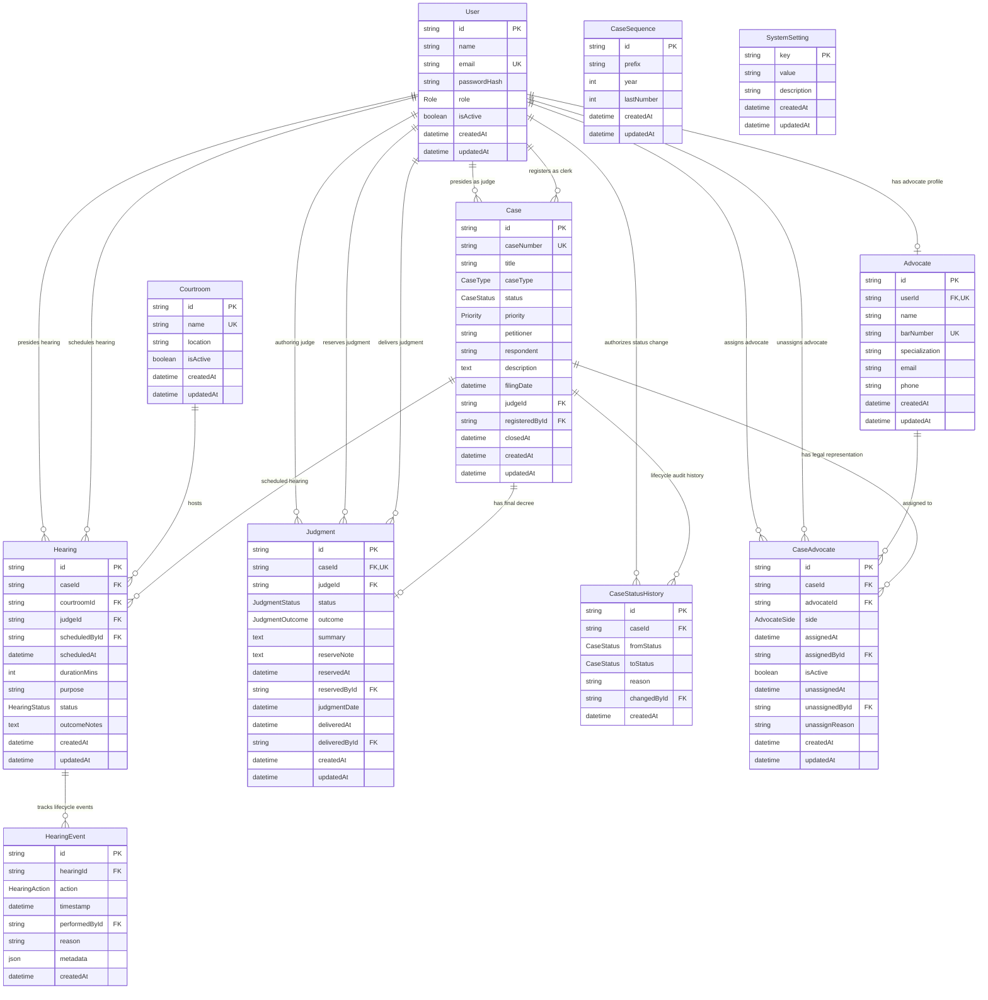

# Court Case Management System - Database Documentation

This document describes the schema architecture, relationships, lifecycle state transitions, data dictionary, and seed demo records for the **Court Case Management System (Court CMS)**.

---

## 1. Entity-Relationship (ER) Diagram



---

## 2. Data Dictionary

### Table: `users`

Represents court administrative personnel, judges, registrars, and practicing legal counsel with portal logins.

| Column          | Type         | Constraints      | Description                               |
| :-------------- | :----------- | :--------------- | :---------------------------------------- |
| `id`            | VARCHAR(191) | PK, UUID         | Unique user identifier                    |
| `name`          | VARCHAR(191) | NOT NULL         | Full name of the user                     |
| `email`         | VARCHAR(191) | UNIQUE, NOT NULL | Login and notification email              |
| `password_hash` | VARCHAR(191) | NOT NULL         | Salted bcrypt password hash               |
| `role`          | ENUM         | NOT NULL         | `ADMIN`, `REGISTRAR`, `JUDGE`, `ADVOCATE` |
| `is_active`     | BOOLEAN      | DEFAULT TRUE     | Account active/disabled status            |
| `created_at`    | DATETIME(3)  | DEFAULT NOW()    | Record creation timestamp                 |
| `updated_at`    | DATETIME(3)  | UPDATED AT       | Last modification timestamp               |

---

### Table: `advocates`

Master directory of legal practitioners registered with the Bar Council.

| Column           | Type         | Constraints                    | Description                                          |
| :--------------- | :----------- | :----------------------------- | :--------------------------------------------------- |
| `id`             | VARCHAR(191) | PK, UUID                       | Unique advocate identifier                           |
| `user_id`        | VARCHAR(191) | UNIQUE, FK(users.id), NULLABLE | Linked login account (if registered on portal)       |
| `name`           | VARCHAR(191) | NOT NULL                       | Advocate full legal name                             |
| `bar_number`     | VARCHAR(191) | UNIQUE, NOT NULL               | Bar Council enrollment number (e.g., `TN/2011/0456`) |
| `specialization` | VARCHAR(191) | NOT NULL                       | Legal domain specialty (e.g., Criminal, Corporate)   |
| `email`          | VARCHAR(191) | NOT NULL                       | Contact email address                                |
| `phone`          | VARCHAR(191) | NOT NULL                       | Contact mobile telephone number                      |
| `created_at`     | DATETIME(3)  | DEFAULT NOW()                  | Registration timestamp                               |
| `updated_at`     | DATETIME(3)  | UPDATED AT                     | Last modification timestamp                          |

---

### Table: `courtrooms`

Physical or virtual court chambers and hearing halls within the judicial complex.

| Column       | Type         | Constraints      | Description                                            |
| :----------- | :----------- | :--------------- | :----------------------------------------------------- |
| `id`         | VARCHAR(191) | PK, UUID         | Unique courtroom identifier                            |
| `name`       | VARCHAR(191) | UNIQUE, NOT NULL | Hall name (e.g., `Court Hall 1 (Chief Justice Bench)`) |
| `location`   | VARCHAR(191) | NOT NULL         | Physical location or virtual bench URL                 |
| `is_active`  | BOOLEAN      | DEFAULT TRUE     | Operational availability flag                          |
| `created_at` | DATETIME(3)  | DEFAULT NOW()    | Record creation timestamp                              |
| `updated_at` | DATETIME(3)  | UPDATED AT       | Last modification timestamp                            |

---

### Table: `cases`

Master judicial docket tracking cases across their entire lifecycle.

| Column             | Type         | Constraints                    | Description                                                                        |
| :----------------- | :----------- | :----------------------------- | :--------------------------------------------------------------------------------- |
| `id`               | VARCHAR(191) | PK, UUID                       | Unique case identifier                                                             |
| `case_number`      | VARCHAR(191) | UNIQUE, NOT NULL               | Official court docket number (e.g., `CC/2026/00187`)                               |
| `title`            | VARCHAR(191) | NOT NULL                       | Cause title (e.g., `Petitioner vs. Respondent`)                                    |
| `case_type`        | ENUM         | NOT NULL                       | `CRIMINAL`, `CIVIL`, `FAMILY`, `PROPERTY`, `COMMERCIAL`, `CONSTITUTIONAL`, `OTHER` |
| `status`           | ENUM         | NOT NULL, DEFAULT `REGISTERED` | Lifecycle status (see section 3)                                                   |
| `priority`         | ENUM         | NOT NULL, DEFAULT `NORMAL`     | `NORMAL`, `URGENT`                                                                 |
| `petitioner`       | VARCHAR(191) | NOT NULL                       | Plaintiff / Complainant name                                                       |
| `respondent`       | VARCHAR(191) | NOT NULL                       | Defendant / Accused name                                                           |
| `description`      | TEXT         | NULLABLE                       | Brief narrative of cause of action / charges                                       |
| `filing_date`      | DATETIME(3)  | NOT NULL                       | Formal filing date at Registry                                                     |
| `judge_id`         | VARCHAR(191) | FK(users.id), NULLABLE         | Assigned presiding judge                                                           |
| `registered_by_id` | VARCHAR(191) | FK(users.id), NOT NULL         | Registrar / Clerk entering docket                                                  |
| `closed_at`        | DATETIME(3)  | NULLABLE                       | Timestamp when delivered judgment closed case                                      |
| `created_at`       | DATETIME(3)  | DEFAULT NOW()                  | System creation timestamp                                                          |
| `updated_at`       | DATETIME(3)  | UPDATED AT                     | Last system modification timestamp                                                 |

_Indexes_: `status`, `filing_date`, `case_type`.

---

### Table: `case_advocates`

Associates practicing advocates with a case under a specific side of representation. Tracks full lifecycle audit trail including who assigned the counsel, when representation ended, who authorized unassignment, and the recorded legal/administrative justification.

| Column             | Type         | Constraints                | Description                                        |
| :----------------- | :----------- | :------------------------- | :------------------------------------------------- |
| `id`               | VARCHAR(191) | PK, UUID                   | Unique assignment identifier                       |
| `case_id`          | VARCHAR(191) | FK(cases.id), NOT NULL     | Associated case                                    |
| `advocate_id`      | VARCHAR(191) | FK(advocates.id), NOT NULL | Assigned counsel                                   |
| `side`             | ENUM         | NOT NULL                   | Representation side: `PETITIONER`, `RESPONDENT`    |
| `assigned_at`      | DATETIME(3)  | DEFAULT NOW()              | Vakalatnama filing / assignment date               |
| `assigned_by_id`   | VARCHAR(191) | FK(users.id), NULLABLE     | Staff user (Admin/Registrar) performing assignment |
| `is_active`        | BOOLEAN      | DEFAULT TRUE               | Active representation indicator                    |
| `unassigned_at`    | DATETIME(3)  | NULLABLE                   | Timestamp when representation ceased               |
| `unassigned_by_id` | VARCHAR(191) | FK(users.id), NULLABLE     | Staff user (Admin/Registrar) authorizing removal   |
| `unassign_reason`  | VARCHAR(500) | NULLABLE                   | Mandatory recorded justification for unassignment  |
| `created_at`       | DATETIME(3)  | DEFAULT NOW()              | Record creation timestamp                          |
| `updated_at`       | DATETIME(3)  | UPDATED AT                 | Last modification timestamp                        |

_Constraints_: Unique composite constraint on `(case_id, advocate_id)`.

---

### Table: `hearings`

Scheduled court proceedings sessions for cases on the daily cause list.

| Column            | Type         | Constraints                   | Description                                           |
| :---------------- | :----------- | :---------------------------- | :---------------------------------------------------- |
| `id`              | VARCHAR(191) | PK, UUID                      | Unique hearing identifier                             |
| `case_id`         | VARCHAR(191) | FK(cases.id), NOT NULL        | Target case                                           |
| `courtroom_id`    | VARCHAR(191) | FK(courtrooms.id), NOT NULL   | Allocated courtroom                                   |
| `judge_id`        | VARCHAR(191) | FK(users.id), NOT NULL        | Presiding judge                                       |
| `scheduled_by_id` | VARCHAR(191) | FK(users.id), NOT NULL        | Staff user / Registrar who scheduled the hearing      |
| `scheduled_at`    | DATETIME(3)  | NOT NULL                      | Session start timestamp (IST working hours)           |
| `duration_mins`   | INT          | DEFAULT 30                    | Allocated duration in minutes                         |
| `purpose`         | VARCHAR(191) | NOT NULL                      | Purpose of listing (e.g., Arguments, Framing Charges) |
| `status`          | ENUM         | NOT NULL, DEFAULT `SCHEDULED` | `SCHEDULED`, `COMPLETED`, `ADJOURNED`, `CANCELLED`    |
| `outcome_notes`   | TEXT         | NULLABLE                      | Daily court order summary / bench remarks             |
| `created_at`      | DATETIME(3)  | DEFAULT NOW()                 | Creation timestamp                                    |
| `updated_at`      | DATETIME(3)  | UPDATED AT                    | Modification timestamp                                |

_Indexes_: `scheduled_at`, `(courtroom_id, scheduled_at)`, `(judge_id, scheduled_at)`.

---

### Table: `hearing_events`

Append-only immutable lifecycle event log tracking every action performed on court hearings (`SCHEDULED`, `RESCHEDULED`, `CANCELLED`, `COMPLETED`, `ADJOURNED`).

| Column            | Type         | Constraints               | Description                                                                              |
| :---------------- | :----------- | :------------------------ | :--------------------------------------------------------------------------------------- |
| `id`              | VARCHAR(191) | PK, UUID                  | Unique event identifier                                                                  |
| `hearing_id`      | VARCHAR(191) | FK(hearings.id), NOT NULL | Associated hearing record                                                                |
| `action`          | ENUM         | NOT NULL                  | `SCHEDULED`, `RESCHEDULED`, `CANCELLED`, `COMPLETED`, `ADJOURNED`                        |
| `timestamp`       | DATETIME(3)  | DEFAULT NOW()             | Event occurrence timestamp                                                               |
| `performed_by_id` | VARCHAR(191) | FK(users.id), NULLABLE    | User who performed or authorized the action                                              |
| `reason`          | TEXT         | NULLABLE                  | Recorded justification (mandatory for cancellation, adjournment, rescheduling)           |
| `metadata`        | JSON         | NULLABLE                  | Additional event context (e.g., previous slot, next hearing ID, outcome notes, warnings) |
| `created_at`      | DATETIME(3)  | DEFAULT NOW()             | Record creation timestamp                                                                |

_Indexes_: `hearing_id`, `(hearing_id, timestamp)`.

---

### Table: `judgments`

Final orders, reserved judgments, and decrees delivered by presiding judges.

| Column            | Type         | Constraints                      | Description                                                             |
| :---------------- | :----------- | :------------------------------- | :---------------------------------------------------------------------- |
| `id`              | VARCHAR(191) | PK, UUID                         | Unique judgment ID                                                      |
| `case_id`         | VARCHAR(191) | UNIQUE, FK(cases.id)             | One-to-one link to case docket                                          |
| `judge_id`        | VARCHAR(191) | FK(users.id), NOT NULL           | Authoring / presiding judge                                             |
| `status`          | ENUM         | NOT NULL, DEFAULT `RESERVED`     | `RESERVED`, `DELIVERED`                                                 |
| `outcome`         | ENUM         | NULLABLE (mandatory on delivery) | `ALLOWED`, `DISMISSED`, `CONVICTED`, `ACQUITTED`, `SETTLED`, `DISPOSED` |
| `summary`         | TEXT         | NULLABLE (mandatory on delivery) | Operative findings and judicial reasoning                               |
| `reserve_note`    | TEXT         | NULLABLE                         | Note recorded when arguments conclude and judgment is reserved          |
| `reserved_at`     | DATETIME(3)  | DEFAULT NOW()                    | Date and time judgment was formally reserved                            |
| `reserved_by_id`  | VARCHAR(191) | FK(users.id), NULLABLE           | User (judge or admin) who reserved the judgment                         |
| `judgment_date`   | DATETIME(3)  | NULLABLE                         | Calendar date of judgment pronouncement                                 |
| `delivered_at`    | DATETIME(3)  | NULLABLE                         | Date and time delivered in open court                                   |
| `delivered_by_id` | VARCHAR(191) | FK(users.id), NULLABLE           | User (judge or admin) who delivered the judgment                        |
| `created_at`      | DATETIME(3)  | DEFAULT NOW()                    | Record creation timestamp                                               |
| `updated_at`      | DATETIME(3)  | UPDATED AT                       | Modification timestamp                                                  |

_Indexes_: `case_id` (unique), `status`, `outcome`, `judgment_date`, `reserved_at`, `judge_id`.

---

### Table: `case_status_history`

Append-only immutable audit trail capturing every case status transition.

| Column          | Type         | Constraints            | Description                                  |
| :-------------- | :----------- | :--------------------- | :------------------------------------------- |
| `id`            | VARCHAR(191) | PK, UUID               | Unique log entry identifier                  |
| `case_id`       | VARCHAR(191) | FK(cases.id), NOT NULL | Associated case                              |
| `from_status`   | ENUM         | NULLABLE               | Previous status (`null` upon initial filing) |
| `to_status`     | ENUM         | NOT NULL               | New status reached                           |
| `reason`        | VARCHAR(191) | NOT NULL               | Audit justification for transition           |
| `changed_by_id` | VARCHAR(191) | FK(users.id), NULLABLE | User who authorized transition               |
| `created_at`    | DATETIME(3)  | DEFAULT NOW()          | Transition timestamp                         |

_Indexes_: `case_id`.

---

### Table: `case_sequences`

Thread-safe counter table supporting automated generation of consecutive case docket numbers.

| Column        | Type         | Constraints   | Description                         |
| :------------ | :----------- | :------------ | :---------------------------------- |
| `id`          | VARCHAR(191) | PK, UUID      | Sequence record ID                  |
| `prefix`      | VARCHAR(191) | NOT NULL      | Docket prefix (e.g., `CC`)          |
| `year`        | INT          | NOT NULL      | Filing calendar year (e.g., `2026`) |
| `last_number` | INT          | DEFAULT 0     | Last sequential integer generated   |
| `created_at`  | DATETIME(3)  | DEFAULT NOW() | Sequence creation date              |
| `updated_at`  | DATETIME(3)  | UPDATED AT    | Last generation timestamp           |

_Constraints_: Unique composite index on `(prefix, year)`.

---

### Table: `system_settings`

Global key-value configuration repository for court-wide thresholds, operating hours, and operational flags.

| Setting Key                           | Default Value                                         | Description                                                                                                      |
| :------------------------------------ | :---------------------------------------------------- | :--------------------------------------------------------------------------------------------------------------- |
| `backlog_threshold_days`              | `90`                                                  | Case pendency threshold in days beyond which active cases are flagged on backlog monitor                         |
| `court_jurisdiction`                  | `District & Sessions Court, Central Judicial Complex` | Official court jurisdiction title                                                                                |
| `advocate_workload_warning_threshold` | `15`                                                  | Active open cases threshold beyond which a soft workload warning is flagged                                      |
| `court_timezone`                      | `Asia/Kolkata`                                        | Primary legal and operational timezone for judicial hearings                                                     |
| `court_start_time`                    | `10:00`                                               | Daily court commencement time in 24h format                                                                      |
| `court_end_time`                      | `17:00`                                               | Daily court concluding time in 24h format                                                                        |
| `lunch_start`                         | `13:00`                                               | Judicial lunch recess start time                                                                                 |
| `lunch_end`                           | `14:00`                                               | Judicial lunch recess end time                                                                                   |
| `court_working_days`                  | `MON,TUE,WED,THU,FRI`                                 | Comma-separated operational court days of the week                                                               |
| `slot_minutes`                        | `15`                                                  | Granular duration increment for hearing scheduling slots in minutes                                              |
| `judge_workload_warning_threshold`    | `25`                                                  | Active open cases threshold beyond which a soft workload warning is flagged for judges                           |
| `stale_case_no_advocate_days`         | `14`                                                  | Case pendency threshold in days beyond which a REGISTERED case with no advocate is flagged as stale              |
| `stale_case_no_hearing_days`          | `21`                                                  | Case pendency threshold in days beyond which an ADVOCATE_ASSIGNED case with no hearings ever is flagged as stale |
| `upcoming_hearings_window_days`       | `7`                                                   | Forward-looking window in days for upcoming hearings monitoring and metrics                                      |

_Audit Trail Rows_: Administrative adjustments to threshold settings via `PATCH /api/v1/dashboard/settings` dynamically record audit entries under individual rows with the prefix `audit:<timestamp>:<uuid>`, preserving complete historical accountability.

---

## 3. Case Status Lifecycle & Implied Records

The court case management system implements a strict, sequential state machine:

```
[ REGISTERED ] ──> [ ADVOCATE_ASSIGNED ] ──> [ HEARING_SCHEDULED ]
                                                       │
[ CLOSED ] <── [ JUDGMENT_RESERVED ] <── [ UNDER_TRIAL ]
```

### State Consistency Constraints

| Lifecycle Status        | Implied & Mandatory Records                                                                      | Disallowed Records                            |
| :---------------------- | :----------------------------------------------------------------------------------------------- | :-------------------------------------------- |
| **`REGISTERED`**        | Case record filed; registrar recorded.                                                           | Must have **0** advocates and **0** hearings. |
| **`ADVOCATE_ASSIGNED`** | At least **1 active `CaseAdvocate`** assigned to petitioner/respondent.                          | Must have **0** scheduled hearings.           |
| **`HEARING_SCHEDULED`** | Active advocates assigned + at least **1 future `SCHEDULED` hearing** on cause list.             | Cannot have delivered judgments.              |
| **`UNDER_TRIAL`**       | Active advocates assigned + at least **1 past `COMPLETED` hearing**.                             | Cannot have closed date.                      |
| **`JUDGMENT_RESERVED`** | Active `Judgment` record with `status: RESERVED` and `reservedOn` populated.                     | Cannot have future scheduled hearings.        |
| **`CLOSED`**            | Active `Judgment` record with `status: DELIVERED`, `outcome` populated, and `Case.closedAt` set. | Case is final; further hearings locked.       |

---

## 4. Seeded Demo Accounts

All demo accounts are configured with the demo password: **`Demo@1234`**.

> ⚠️ **Notice**: These credentials are strictly for local testing and demo validation. They must not be deployed to public or production environments.

| Role          | Name                           | Email                               | Password    | Details                              |
| :------------ | :----------------------------- | :---------------------------------- | :---------- | :----------------------------------- |
| **ADMIN**     | Rajesh Varma                   | `admin@courtcms.gov.in`             | `Demo@1234` | Full system administrator            |
| **REGISTRAR** | Sunita Sharma                  | `registrar@courtcms.gov.in`         | `Demo@1234` | Chief Clerk (Filing & Allocation)    |
| **JUDGE**     | Hon. Justice D. Y. Swaminathan | `judge.swaminathan@courtcms.gov.in` | `Demo@1234` | Presiding Judge (Bench A)            |
| **JUDGE**     | Hon. Justice Ruma Banerjee     | `judge.banerjee@courtcms.gov.in`    | `Demo@1234` | Presiding Judge (Bench B)            |
| **ADVOCATE**  | Harish Mehta                   | `adv.mehta@courtcms.gov.in`         | `Demo@1234` | Bar No: `D/1998/0142` (Criminal Law) |
| **ADVOCATE**  | Priya Iyer                     | `adv.iyer@courtcms.gov.in`          | `Demo@1234` | Bar No: `TN/2007/0891` (Commercial)  |
| **ADVOCATE**  | Zafar Khan                     | `adv.khan@courtcms.gov.in`          | `Demo@1234` | Bar No: `MAH/2012/1045` (Property)   |

_Additional Unlinked Advocates (External Counsel)_:

- Anand Grover (`anand.grover@bar.org.in`, Bar No: `DL/2002/0543`)
- Meenakshi Sundaram (`m.sundaram@bar.org.in`, Bar No: `KA/2015/0732`)
- Vikram Deshmukh (`v.deshmukh@bar.org.in`, Bar No: `WB/2010/0219`)

---

## 5. Database Operational Commands

All database management scripts can be invoked from the root repository or from `server/`:

```powershell
# 1. Apply latest migrations
npm run db:migrate

# 2. Populate / Re-seed realistic demo data
npm run db:seed

# 3. Clean reset database and automatically re-seed
npm run db:reset

# 4. Open Prisma Studio visual browser interface
npm run db:studio

# 5. Execute automated integrity & business rule verification
npm run db:verify
```
